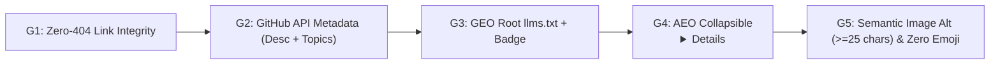

# GitHub Presence SEO, AEO & GEO Deterministic Workflow and Harness

## Purpose
Ensure every GitHub Personal Profile (`<user>/<user>`), Organization Profile (`<org>/.github`), and Open-Source Repository achieves 100% machine-readability across traditional search engines (Google SEO), conversational answer engines (Perplexity, ChatGPT Search, Google AI Overviews — AEO), and autonomous coding agents (Claude Code, Codex, Antigravity — GEO) without compromising minimalist visual craft.

## The 5-Layer Architecture & Harness Gates



| Gate ID | Layer | Requirement | Machine Consumer |
| :--- | :--- | :--- | :--- |
| **`G1_LINKS_NO_404`** | Technical SEO | 100% of `href` and Markdown links resolve `HTTP 200` (`PUBLIC` visibility; zero private/404 repo dead-ends). | Googlebot, Bingbot, Link Graph Crawlers |
| **`G2_GITHUB_METADATA`** | SERP & GitHub Search | Every linked repository defines a 120–160 char `description` (`<meta description>`), `homepageUrl`, and `>= 3` semantic `repositoryTopics`. | Google SERP Snippets, GitHub Topic Index |
| **`G3_GEO_LLMS_TXT`** | Generative Engine (GEO) | Root `llms.txt` following `llmstxt.org` (`# Title`, `> Entity Summary`, canonical links, Q&A) + monochrome badge in README header. | Claude Code, Codex, Cursor, ChatGPT Search |
| **`G4_AEO_FAQ_INDEX`** | Answer Engine (AEO) | Collapsible `<details><summary>` block at README footer with Subject-Predicate-Object Q&As (`**Question?**`) and a flat Markdown registry table. | Perplexity, Google AI Overviews, SearchGPT |
| **`G5_SEMANTIC_IMG_ALT`** | Visual & DOM Semantics | Every non-badge `` carries a keyword-rich `alt` attribute (`>= 25` chars) describing `<Brand> <Engine> — <Primary Capability>`; zero emojis. | Google Image Search, Screen & AI DOM Parsers |

---

## Standard Operating Workflow (3-Step Rapid Application)

### Step 1: Batch-Populate GitHub Repository Metadata (`G2`)
Run `gh repo edit` across all public ecosystem repositories so Google and GitHub Search index the canonical `<meta name="description">`, live Pages URL, and topic cluster:

```bash
gh repo edit <owner>/<repo> \
  --description "<120-160 char Subject-Predicate-Object proposition>" \
  --homepage "https://<owner>.github.io/<repo>/" \
  --add-topic "ai-agents,claude-code,codex,design-system,aeo,geo,llms-txt"
```

### Step 2: Author Root `llms.txt` & Collapsible AEO `<details>` Block (`G3` + `G4` + `G5`)
1. Create `llms.txt` at repository root with `# Entity Name`, `> 2-sentence canonical summary`, `## Flagship & Specialized Ecosystem Repositories`, and `## Canonical Answers for AI Search & Answer Engines (AEO)`.
2. Add a monochrome `llms.txt` badge to the README top badge strip:
   ```markdown
   <a href="https://raw.githubusercontent.com/<owner>/<repo>/main/llms.txt"></a>
   ```
3. Expand every card `` to `>= 25` characters (`<System> — <Primary Capability and Tech Stack>`).
4. Append the collapsed `<details>` AEO FAQ & Markdown Registry table at the bottom of `README.md` (invisible until clicked, preserving minimalist UI while exposing 100% semantic text in the HTML DOM).

### Step 3: Run the Deterministic Harness Verification (`G1`–`G5`)
Execute `scripts/seo-aeo-geo-harness.py` to verify all 5 gates and generate visual scorecard proof:

```bash
python3 /Users/jang/Products/design-os-github-page/scripts/seo-aeo-geo-harness.py \
  --target /Users/jang/Products/jangtrinh jangtrinh \
  --target /Users/jang/Products/easestart-.github EaseStart \
  --check-links \
  --html-report ./seo-aeo-geo-scorecard.html
```

## Failure Modes (Mandatory)
1. **Card Link 404 / Private Repo Leak**: Linking a showcase card to a renamed or `PRIVATE` repository causes search crawlers to record 404 dead-ends and drop outbound link equity.
2. **Short Generic Alt Text**: Using 1–2 word `alt="Logo"` or `alt="App"` inside HTML `<table>` cards hides the product's technical capabilities from Google Image Search and DOM text extractors.
3. **Uncollapsed Prose Wall**: Dumping raw SEO keyword tables directly into the visible README body destroys minimalist visual hierarchy; always wrap the AEO Q&A and full text registry inside `<details><summary>...</summary>...</details>`.
4. **Empty GitHub Repo Description/Topics**: Leaving GitHub's native repository `description` or `topics` blank forces Google to guess the `<meta description>` from raw file names.
