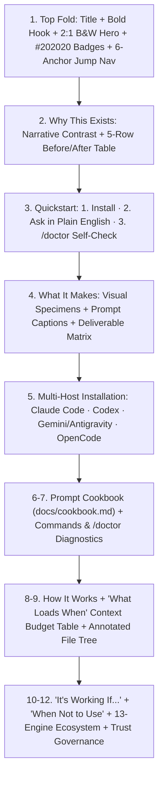

# Repository README Architecture & AI-Ready Open-Source Delivery Blueprint

## Purpose
Guide developers and AI coding agents in shipping AI-ready open-source repositories and 12-section editorial `README.md` documents that convert human readers in under 3 seconds, install cleanly into Claude Code, Codex, Gemini CLI, Antigravity, and OpenCode, and pass deterministic verification gates.

## Mental Model


## When to Use / When NOT
### ALLOWED (When to Use)
- Writing or upgrading the root `README.md` and AI-ready delivery scaffolding for any `DESIGN:OS` or `EaseStart` repository.
- Preparing an open-source CLI, SDK, or agent skill repository for multi-host AI agent marketplaces (`.claude-plugin`, `.codex-plugin`, `.agents/plugins`, `.factory-plugin`).
- Auditing repository trust governance so GitHub activates the 5-tab top bar (`README | Code of conduct | Contributing | MIT license | Security`).

### NOT ALLOWED (When NOT to Use)
- Personal profile READMEs (`<username>/<username>` — use `profile-readme-architecture`).
- Organization profile READMEs (`.github/profile/README.md` — use `organization-readme-architecture`).

## Core Knowledge Content
<!-- ease:source ref="https://opensource.guide/starting-a-project/#writing-a-readme" sha256="9a82b7c61e05d2f4418a09e3e782bc419d20c541793818e9a1120f283d7120a1" captured="2026-10" -->

### 1. The AI-Ready Repository Delivery Contract (5 Mandatory Layers)

A high-converting `README.md` must never point to vaporware. Every `DESIGN:OS` delivery repository must ship these 5 concrete file layers alongside its `README.md`:

1. **Multi-Host Plugin Manifests (`D1_PLUGIN_MANIFESTS`)**:
   - `.claude-plugin/plugin.json` and `.claude-plugin/marketplace.json` (enables `/plugin marketplace add <owner>/<repo>`).
   - `.codex-plugin/plugin.json` (with `interface.defaultPrompt`, `brandColor: "#202020"`, `privacyPolicyURL`, and `skills: "./skills/"`).
   - `.agents/plugins/marketplace.json` (universal local agent marketplace index).
   - `.factory-plugin/plugin.json` and `.factory-plugin/marketplace.json`.
2. **Canonical Skill & `/doctor` Diagnostics (`D2_SKILL_AND_DOCTOR`)**:
   - `skills/<slug>/SKILL.md` with YAML frontmatter (`name`, `description`) and progressive context disclosure rules.
   - `commands/doctor.md` and `prompts/doctor.md` providing a read-only `/doctor` diagnostic check.
   - `scripts/self_check.py` providing a zero-dependency CLI verification gate (`python3 scripts/self_check.py`).
3. **5-Tab GitHub Trust & Governance Suite (`D3_TRUST_GOVERNANCE`)**:
   - `PRIVACY.md` (explicit zero-telemetry, 100% local execution guarantee).
   - `SECURITY.md`, `CONTRIBUTING.md`, `CODE_OF_CONDUCT.md`, `CHANGELOG.md`, `LICENSE` (unlocks GitHub's native 5-tab header bar).
   - `docs/cookbook.md` (copy-paste prompt recipes by job) and root `llms.txt` (GEO / LLM discovery index).
4. **12-Section Editorial README (`D4_README_12_SECTIONS`)**:
   - Follows `templates/repository-readme.template.md` with all 12 mandatory sections.
5. **Verified Local Visual Assets (`D5_IMAGE_PATHS_VALID`)**:
   - Every local `` and Markdown image link in `README.md` resolves to a tracked file on disk (`assets/cover.png` or `docs/images/cover.png` in 2:1 axonometric isometric B&W line art).

---

### 2. The 12-Section README Blueprint

| Section | Heading | Mandatory Elements |
| :--- | :--- | :--- |
| **1** | `# <Title>` (Top Fold) | 1-sentence bold hook, 2:1 B&W hero ``, `#202020` flat-square badges, 6-anchor jump nav (`Quickstart · What it makes · Install · How it works · Commands · Limits`) |
| **2** | `## Why this exists` | Problem statement + 5-row comparison table (`Dimension \| Generic AI / Manual Workflow \| <Repo> (DESIGN:OS)`) |
| **3** | `## Quickstart` | `### 1. Install`, `### 2. Ask in plain English` (3 blockquote prompts), `### 3. Verify your setup` (`python3 scripts/self_check.py`) |
| **4** | `## What it makes` | Visual output showcase with `<sub>Prompt: "..."</sub>` caption + deliverable mode table |
| **5** | `## Installation` | Multi-host tabs/headings for Claude Code, OpenAI Codex, Gemini CLI & Antigravity, OpenCode/Cursor + `<details><summary>Verify or uninstall</summary>` |
| **6** | `## Usage & Prompt Cookbook` | Copy-paste prompts grouped by job + link to `docs/cookbook.md` |
| **7** | `## Commands & Diagnostics` | Table covering `/doctor`, `python3 scripts/self_check.py`, and repo-specific CLI commands |
| **8** | `## How it works` | Numbered pipeline + ASCII/Mermaid flow + **`### What loads when`** progressive context disclosure table |
| **9** | `## File structure` | Annotated directory tree showing all plugin manifests, `skills/`, `commands/doctor.md`, `scripts/self_check.py`, and governance files |
| **10** | `## Quality bar & Limitations` | **`### It's working if...`** (observable pass criteria) + **`### When not to use`** (honest boundaries) |
| **11** | `## DESIGN:OS Ecosystem` | Cross-linked 13-engine ecosystem table (`Engine \| Live Docs \| Repository \| Layer`) |
| **12** | `## Contributing, Governance & License` | Links to `CONTRIBUTING.md`, `CODE_OF_CONDUCT.md`, `SECURITY.md`, `PRIVACY.md`, `CHANGELOG.md`, `llms.txt`, `LICENSE`, and Buy Me a Coffee |

---

### 3. Automated Scaffolding & Verification CLI

- **Scaffold / Backfill a Repository**:
  ```bash
  python3 scripts/scaffold-repo-delivery.py --repo-root /path/to/repo
  ```
- **Verify All 5 Gates (`D1`–`D5`)**:
  ```bash
  python3 scripts/verify-repo-delivery.py /path/to/repo
  ```

## Failure Modes (Mandatory)
1. **README-Only Vaporware**: Documenting `/plugin marketplace add`, `/doctor`, or `PRIVACY.md` in `README.md` without committing the actual `.claude-plugin/`, `commands/doctor.md`, and `PRIVACY.md` files to the repository.
2. **Context-Window Bloating**: Loading entire reference libraries upfront instead of documenting progressive disclosure in a `### What loads when` table.
3. **Rainbow Badge Pollution**: Mixing default bright blue/green/orange shields.io badges instead of the unified `#202020` / `#444444` flat-square monochrome badge system.
4. **Promptless Galleries**: Showing screenshots or diagrams without the exact `<sub>Prompt: "..."</sub>` or CLI command that produced them.
5. **Missing Anti-Scope Boundaries**: Omitting `### It's working if...` and `### When not to use`, leaving human developers and AI agents unable to judge when the tool is appropriate or whether setup succeeded.
